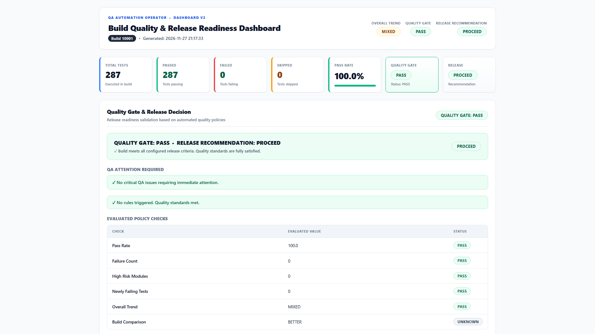
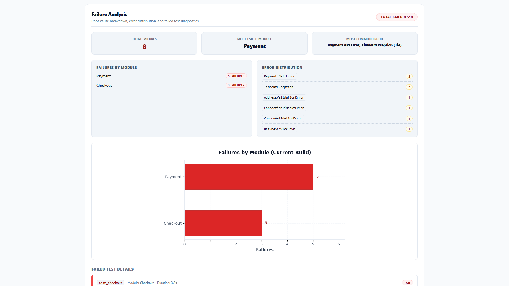
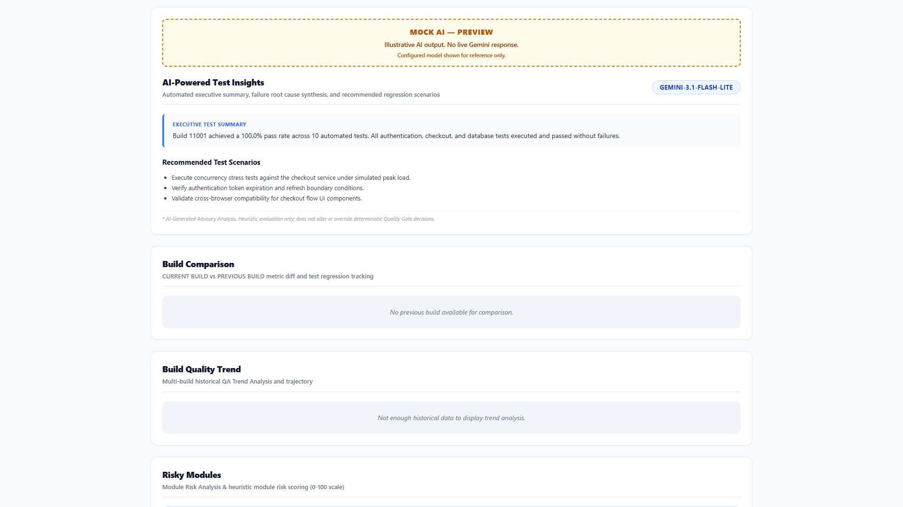
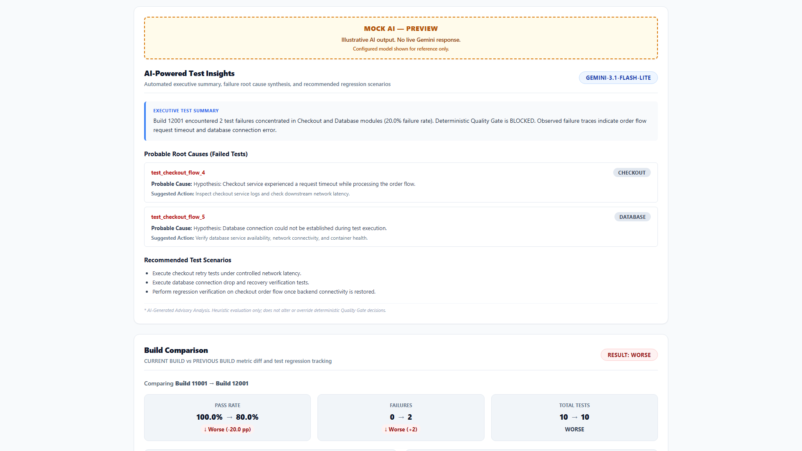
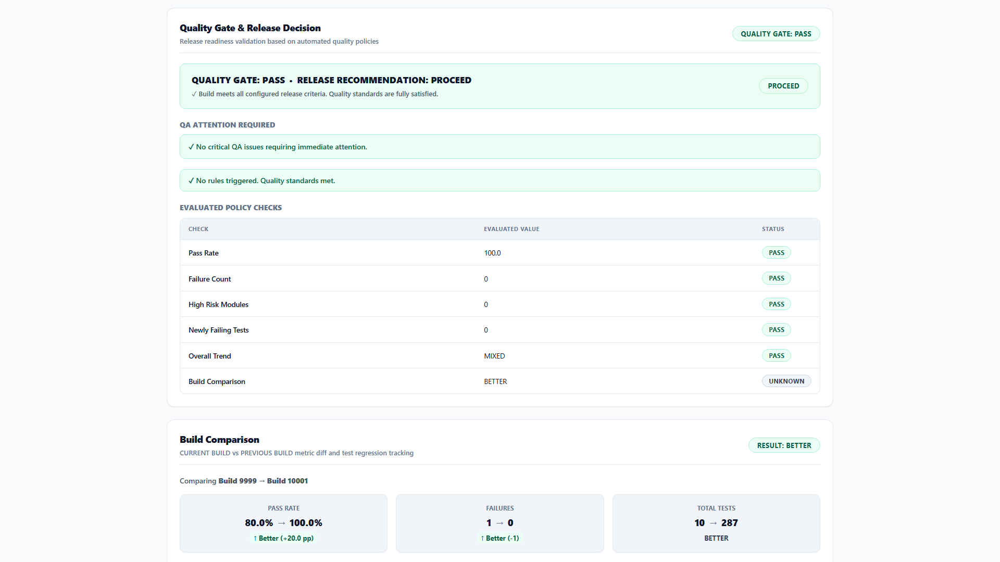
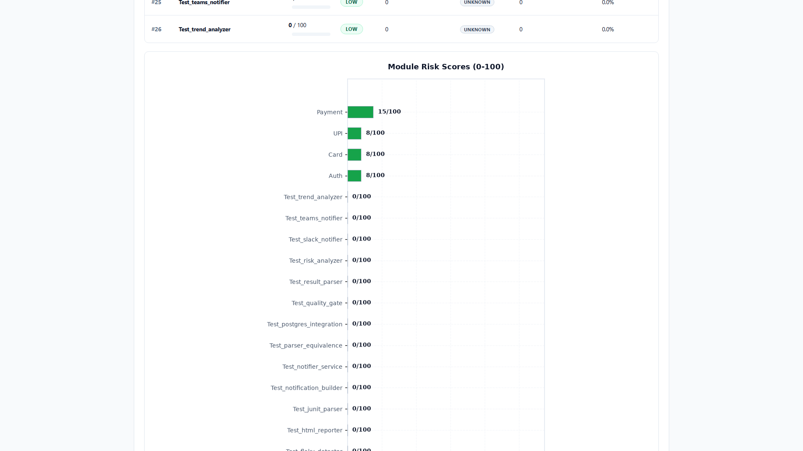
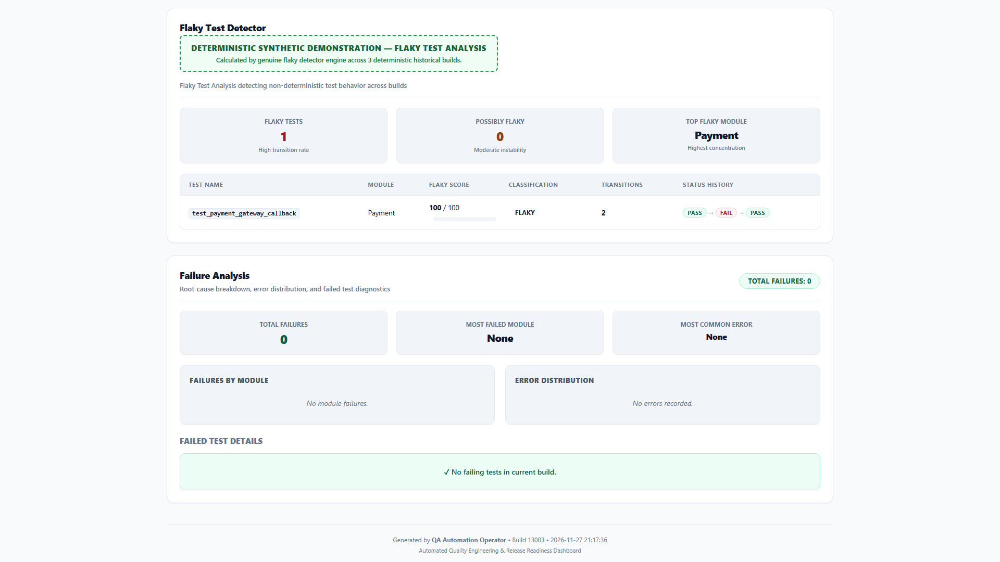

# QA Automation Operator

[](https://github.com/saxenaanirudha/qa-automation-operator)
[](https://github.com/saxenaanirudha/qa-automation-operator)
[](https://www.python.org/)
[](https://fastapi.tiangolo.com/)
[](LICENSE)

A modular QA test operations and test analytics platform designed to ingest automated test results (CSV and JUnit XML), detect regressions, calculate heuristic module risk, identify flaky tests, enforce configurable deterministic Quality Gates, and generate interactive visual dashboards.

Exposes both a resilient CLI interface and an async FastAPI REST service supporting dual-engine persistence (local SQLite and production PostgreSQL). Includes an optional, security-hardened Generative AI preview integration designed to synthesize advisory insights without overriding deterministic release controls.

---

## Visual Dashboard Showcase

The platform generates self-contained, interactive HTML reports featuring visual KPI tiles, automated Quality Gate evaluations, failure diagnostics, dynamic risk distribution charts, and optional AI-assisted summaries.

### 1. Executive Quality & Release Readiness Dashboard
*Demonstrates a genuine historical build report (Build 10001) evaluating 287 automated tests with 100% pass rate, zero failures, and automated Quality Gate PASS/PROCEED authorization.*



> **Data Provenance:** The executive dashboard above reflects a genuine historical test run of **287 automated tests** (Build 10001). This build metric is distinct from the project's internal **323-test regression test suite**.

---

### 2. Failure Diagnostics & Error Distribution
*Demonstrates genuine diagnostic failure clustering (Build 247) with 8 active failures across Payment and Checkout services, deterministic tied-category error handling (`Payment API Error, TimeoutException (Tie)`), and comparative module failure charting.*



---

### 3. Optional Gen AI Preview: Advisory Build Insights
*Illustrative previews rendered under the optional Gen AI preview integration. The UI delivers high-level advisory summaries, hypothetical root causes, and recommended regression scenarios while maintaining strict truth-in-documentation disclosure banners.*

| Successful Build Preview (Build 11001 — 100% Pass) | Failed Build Preview (Build 12001 — 80% Pass / 2 Failures) |
| :---: | :---: |
|  |  |

> **Disclosure:** Previews above are rendered using synthetic 10-test fixtures and mocked responses. The configured model (`gemini-3.1-flash-lite`) is indicated for configuration reference only. No live external API calls were made to render these demonstration assets.

---

### 4. Supplementary Operations Dashboards

<details>
<summary><strong>View Quality Gate Decision & Evaluated Policy Checks</strong></summary>


*Detailed policy check evaluation validating pass rate, failure count, high-risk modules, newly failing tests, trend trajectory, and build comparison metrics.*
</details>

<details>
<summary><strong>View Heuristic Module Risk Analysis (Dynamic Sizing)</strong></summary>


*Ranks application components by defect risk (0–100 scale) based on current failures, historical trend, persistent defect count, and failure share. Features dynamic chart height scaling to maintain readability across large module populations.*
</details>

<details>
<summary><strong>View Flaky Test Transition Detector (Synthetic Demonstration)</strong></summary>


*Shows genuine transition tracking engine (`PASS ↔ FAIL`) across consecutive builds (Build 13001–13003) detecting intermittent instability and scoring flakiness.*
</details>

---

## Core Capabilities & Architecture

```text
       Automation Framework / CI (GitHub Actions, Jenkins, Pytest)
                                 │
                                 ▼
                     CSV / JUnit XML Test Results
                                 │
                 ┌───────────────┴───────────────┐
                 ▼                               ▼
       CLI Interface (main.py)       FastAPI REST Service (port 8000)
                 │                               │
                 │                 ┌─────────────┴─────────────┐
                 │                 ▼                           ▼
                 │         Security Middleware         API Route Handlers
                 │         - Constant-Time API Key     - /health, /builds
                 │         - Sliding Rate Limiter      - /analyze, /analysis
                 │         - Trusted Proxy Filter      - /report, /notify
                 │                 │                           │
                 └─────────────────┼───────────────────────────┘
                                   ▼
                    Core Analytics & Pipeline Engine
         ┌───────────────────────────────────────────────────┐
         │ - Result Parsers (CSV & JUnit XML with XXE Guard) │
         │ - Failure Analysis & Stack Trace Normalizer       │
         │ - Historical Trend & Regression Engine            │
         │ - Heuristic Module Risk Scoring Engine            │
         │ - Flaky Test Transition Detector                  │
         │ - Quality Gate Policy Evaluator                   │
         │ - Optional Gen AI Insights Service (Advisory)     │
         └─────────────────────────┬─────────────────────────┘
                                   ▼
                      Data Persistence Layer
                     (SQLAlchemy 2.0 ORM Engine)
                 ┌─────────────────┴─────────────────┐
                 ▼                                   ▼
        SQLite Database                     PostgreSQL Database
      (sqlite:///qa_results.db)           (postgresql+psycopg2://)
         [Dev & Local Pytest]               [Production & Docker]
                                   │
                 ┌─────────────────┴─────────────────┐
                 ▼                                   ▼
       HTML Dashboard Generator             Notification Dispatcher
      (Standalone Self-Contained)           (Slack & MS Teams Webhooks)
```

### Key Functional Pillars
- **Multi-Format Test Ingestion:** Normalizes both tabular CSV execution logs and standard JUnit XML (single-suite, multi-suite, and nested packages).
- **Security Hardening (Barn Door Protocol):**
  - Constant-time `X-API-Key` authentication via `secrets.compare_digest`.
  - Fail-closed production startup refusing to serve unauthenticated traffic if `API_KEY` is missing in production mode.
  - In-memory sliding-window rate limiting per client IP.
  - Streaming file upload validation (enforced in 64 KB chunks up to 10 MB).
  - XML External Entity (XXE) expansion prevention using defused XML parsing principles.
  - Server-side UUID generation for temporary upload artifacts to eliminate path traversal.
- **Deterministic Quality Gates:** Evaluates builds against configurable release policies, outputting an overall status (`PASS`, `WARNING`, `FAIL`) and actionable recommendation (`PROCEED`, `REVIEW`, `BLOCK`).
- **Heuristic Module Risk Scoring:** Scores modules from 0 to 100 based on failure count, failure share, historical trend, and persistent regressions.
- **Flaky Test Transition Detection:** Calculates flakiness percentages by identifying non-deterministic `PASS ↔ FAIL` switches across chronological build history.
- **Dual Storage Support:** Works out-of-the-box with local SQLite (`qa_results.db`) and scales seamlessly to PostgreSQL with SQLAlchemy connection pooling.
- **Automated Webhook Alerts:** Formats and dispatches structured build summaries and Quality Gate alerts to Slack and Microsoft Teams.

---

## Optional Gen AI Preview

QA Automation Operator includes an optional Generative AI service (`src.services.ai_service`) built using Google Gemini API conventions (`gemini-3.8-flash` / `gemini-3.1-flash-lite`).

### Three Advisory Capabilities
1. **AI Test Result Summary:** High-level narrative summarizing pass rates, critical failure areas, and overall build health.
2. **AI Probable Root Cause Analysis:** Hypothetical root cause explanations mapping error messages and failure traces to suspected technical issues.
3. **AI Recommended Test Scenarios:** Proactive suggestions for regression scenarios, load tests, or boundary validations tailored to observed failures.

### Architectural Safeguards & Disclosures
- **Disabled by Default:** The integration is strictly opt-in (`AI_ENABLED=false`). When disabled or unconfigured, zero external API requests are made.
- **Strict Advisory Decoupling:** AI insights are **strictly advisory**. Deterministic Quality Gate evaluations (`PASS / PROCEED`, `WARNING / REVIEW`, `FAIL / BLOCK`) are computed independently and cannot be altered or overridden by AI responses.
- **Prompt Injection Mitigation & Data Sanitization:** Diagnostic stack traces are isolated within `<diagnostic_telemetry>` mitigation boundary tags, and regex filters automatically redact database credentials, passwords, bearer tokens, API keys, and IP addresses before prompts are constructed.
- **Zero Automatic Retries & Configurable Timeout:** To prevent unexpected quota consumption or runaway cloud billing, requests enforce a 30-second client timeout (`GEMINI_TIMEOUT_SECONDS=30`) with **zero automatic retries**.
- **Graceful Provider Failure Handling:** On provider timeouts, network errors, upstream unavailability (such as HTTP 503 high demand), or unparseable payloads, the service returns `None` and safely omits the advisory section, preserving full deterministic reporting and quality gate evaluation without unhandled exceptions.
- **Truth-in-Documentation Disclosure:**
  - Automated CI and regression verification relies exclusively on mocked responses (`tests/test_ai_service.py`).
  - Genuine live API verification remains blocked by third-party provider availability issues: historical execution resulted in 3 HTTP 503 provider unavailability responses, 2 timeouts, and 1 HTTP 404 response across six (6) total attempts, with zero (0) successful genuine generations received.
  - Demonstration dashboard screenshots utilize synthetic offline fixtures with prominent disclosure notices.
  - Model availability, latency, and free-tier quotas are entirely provider-dependent. This project makes no claims of defect-free, hallucination-free, production-proven, or live AI-validated functionality.

---

## Technology Stack & Requirements

- **Runtime:** Python 3.12+ (tested on Python 3.12.10)
- **Web Framework:** FastAPI 0.115+, Starlette 0.45+, Uvicorn 0.34+
- **Data Analysis & Visualization:** Pandas 2.2+, Matplotlib 3.10+
- **Database & ORM:** SQLAlchemy 2.0+, psycopg2-binary 2.9+
- **Templating & Safety:** Jinja2 3.1+ (with autoescaping active)
- **Networking:** HTTPX 0.28+, Requests 2.32+
- **Testing:** Pytest 9.2+, Pytest-Cov 7.1+

---

## Installation & Quick Start

### 1. Clone & Set Up Virtual Environment

```bash
# Clone the repository
git clone https://github.com/saxenaanirudha/qa-automation-operator.git
cd qa-automation-operator

# Create and activate virtual environment
python -m venv .venv

# On Linux / macOS:
source .venv/bin/activate

# On Windows (PowerShell):
.\.venv\Scripts\Activate.ps1
```

### 2. Install Dependencies

```bash
pip install -r requirements.txt
```

### 3. Configure Environment Variables

```bash
cp .env.example .env
```

| Variable | Default | Purpose |
|---|---|---|
| `ENVIRONMENT` | `development` | Set to `production` to enforce fail-closed security. |
| `API_KEY` | *(empty)* | Secret key for `X-API-Key` authentication. Required in production. |
| `DATABASE_URL` | `sqlite:///qa_results.db` | SQLAlchemy connection string (SQLite or PostgreSQL). |
| `RATE_LIMIT_ENABLED` | `true` | Enables in-memory sliding-window rate limiting. |
| `AI_ENABLED` | `false` | Enables optional advisory Gen AI test insights. |
| `GEMINI_API_KEY` | *(empty)* | Optional Google Gemini API key. Transmitted via `x-goog-api-key` header. |
| `GEMINI_MODEL` | `gemini-3.8-flash` | Configured Gemini model identifier. |
| `GEMINI_TIMEOUT_SECONDS` | `30` | Client request timeout in seconds with zero automatic retries. |

---

## Execution Guide

### Command-Line Interface (CLI)

The CLI runner (`main.py`) operates standalone without requiring the FastAPI service:

```bash
# Ingest and analyze test results from CSV
python main.py --input sample_data/test_results.csv

# Ingest and analyze test results from JUnit XML
python main.py --input sample_data/junit_results.xml --format junit

# Enforce Quality Gate in CI (exits with code 1 if Quality Gate evaluates to FAIL)
python main.py --input sample_data/test_results.csv --enforce-quality-gate

# Generate standalone self-contained HTML report
python main.py --input sample_data/test_results.csv --report

# Dispatch webhook notifications to Slack and Microsoft Teams
python main.py --input sample_data/test_results.csv --notify --slack --teams
```

### FastAPI REST Service

Start the local API daemon:

```bash
uvicorn src.api.app:app --host 127.0.0.1 --port 8000 --reload
```

Interactive documentation is available at:
- **Swagger UI:** `http://localhost:8000/docs`
- **ReDoc:** `http://localhost:8000/redoc`

#### Example Authenticated Ingestion via cURL

```bash
curl -X POST "http://localhost:8000/analyze" \
  -H "X-API-Key: your-secret-api-key" \
  -F "file=@sample_data/test_results.csv" \
  -F "format=csv"
```

---

## Docker & Container Deployment

To launch the operator alongside a managed PostgreSQL database container:

```bash
# Start API service and PostgreSQL daemon
docker compose up -d --build

# Inspect service logs
docker compose logs -f api

# Stop containers while preserving database volume
docker compose down
```

---

## Regression Verification & Test Evidence

The platform enforces strict automated testing using Pytest:

```bash
# Run the complete test suite with coverage
pytest --cov=src --cov-report=term-missing
```

### Verification Baselines & Coverage
- **Consolidated PostgreSQL-Enabled Regression:** **323 collected, 323 passed, zero skipped, zero failures, zero errors** (duration: 88.27s with statement coverage, executed against an isolated PostgreSQL 16 Alpine container on port 5433).
- **PostgreSQL Integration Tests:** **4 passed** (`test_postgres_connectivity_and_schema_init`, `test_postgres_build_persistence`, `test_postgres_duplicate_submission_rollback`, `test_postgres_concurrent_writes`).
- **Targeted Hardening Suite:** **69 passed** (covering population comparability, canonical module identity, non-comparable regression suppression, duplicate rejection, and Quality Gate safety).
- **Overall Statement Coverage:** **92%** (2,006 statements, 162 missed).
- **AI Service Statement Coverage:** **89%** (127 statements, 14 missed).
- **Docker Compose Validation:** Exit code 0 (`docker compose config --quiet` validated successfully against Docker Engine 29.9.3 / Compose v5.7.0).

---

## Known Limitations

1. **PostgreSQL Integration Suite:** 4 integration tests in `tests/test_postgres_integration.py` require an active PostgreSQL container or service. Verified passing (4/4 passed) during containerized execution; in environments where Docker is not running, these tests safely skip.
2. **Build Population Comparability:** Comparing builds with differing test populations (e.g., a 10-test smoke run vs a 287-test full regression) reflects suite expansion or slicing rather than like-for-like stability. The report displays an explicit limitation callout.
3. **Build Comparison Influence on Quality Gate:** Under default configuration, build comparison evaluates canonical test population equivalence (`(module, test_name)`). When test populations differ, false-alarm `WORSE` warnings are suppressed so non-equivalent slices do not inappropriately block releases, while independent failure thresholds (failure count, pass rate, high-risk modules) continue to enforce quality gates strictly.
4. **Heuristic Risk Model:** Risk scores (0–100) are computed algorithmically based on current failure counts, trends, persistent failures, and failure share. They represent heuristic operational risk indicators, not statistically validated defect probabilities.
5. **Live Gen AI Verification:** Real-world Gemini API generation remains unverified in this release due to external provider HTTP 503 provider unavailability. Live verification requires a responsive provider endpoint and valid user credentials.

---

## License

This project is licensed under the terms of the **MIT License**. See the [LICENSE](LICENSE) file for details.
